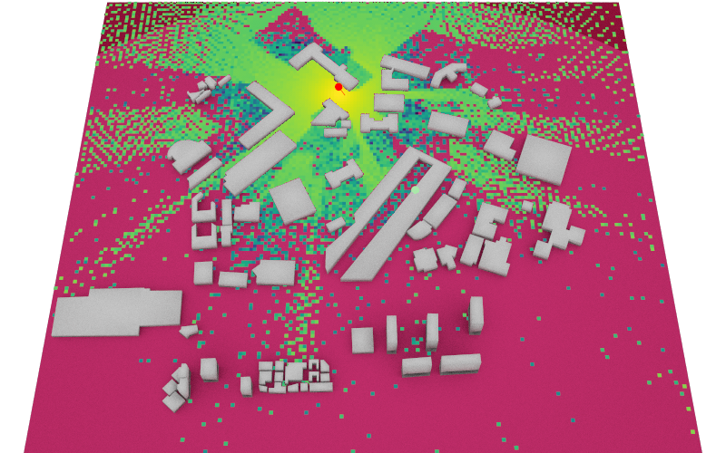
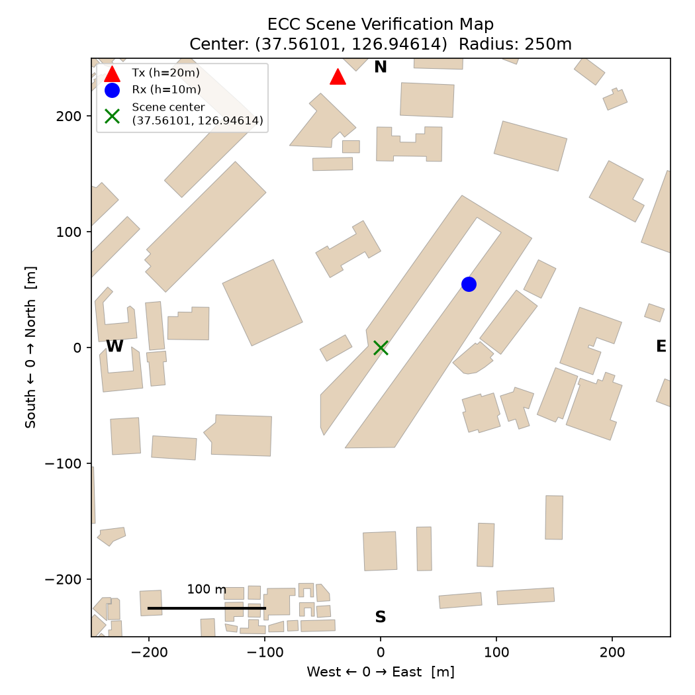

# ECC 3D Scene Ray Tracing and OFDM BER Simulation

This project constructs a 3D radio environment around **Ewha Campus Complex (ECC)** from OpenStreetMap building footprints, computes multipath propagation with Sionna RT, and evaluates an OFDM-QPSK link with repetition coding.

The notebook follows the complete simulation chain:

> OpenStreetMap building data → 3D mesh generation → Sionna RT → channel impulse response → OFDM/QPSK → BER

## Example Outputs

### Ray-traced coverage map



### Geometry and Tx/Rx placement check



## Highlights

- Downloads building footprints around ECC and converts geographic coordinates to a local meter-based coordinate system.
- Extrudes 2D building footprints into 3D PLY meshes using OpenStreetMap height metadata when available.
- Builds a Mitsuba XML scene with ITU radio materials: concrete buildings and wet ground.
- Computes line-of-sight and specular-reflection paths at 3.5 GHz with Sionna RT.
- Visualizes the channel impulse response and OFDM frequency response.
- Compares theoretical and simulated QPSK BER in AWGN with repetition-coded QPSK over the ECC ray-tracing channel.

## Repository Structure

```text
.
├── Lec7_ECC_scene.ipynb          # End-to-end simulation notebook
├── coverage.png                   # Ray-traced coverage-map result
└── ecc_scene/
    ├── scene.xml                  # Mitsuba/Sionna RT scene definition
    ├── scene_verification_map.png # 2D geometry and Tx/Rx placement check
    └── meshes/                    # Generated building and ground PLY meshes
```

## Setup

Create a Python environment compatible with Sionna RT and Mitsuba, then install the required packages:

```bash
pip install sionna osmnx trimesh mapbox-earcut triangle matplotlib pandas scipy shapely torch jupyterlab
```

The notebook was executed with a CUDA-enabled NVIDIA GPU using the `cuda_ad_mono_polarized` Mitsuba variant. A CUDA-capable environment is recommended for practical ray-tracing runtime. Sionna RT also supports CPU-based configurations when the required Mitsuba and LLVM dependencies are available.

## Running the Notebook

1. Open `Lec7_ECC_scene.ipynb` from the repository root.
2. Run the cells from top to bottom.
3. The first part of the notebook queries OpenStreetMap and regenerates the meshes and `ecc_scene/scene.xml`.
4. The later sections render the coverage map and evaluate the OFDM-QPSK BER curves.

An internet connection is required when regenerating the OpenStreetMap scene. The included `ecc_scene/` directory contains the generated mesh and scene assets used for the published results.

## Simulation Configuration

| Item | Value |
| --- | --- |
| Carrier frequency | 3.5 GHz |
| Antennas | Single-element, vertically polarized isotropic Tx/Rx arrays |
| Propagation model | Line-of-sight and specular reflection, maximum depth 5 |
| OFDM | 64-point FFT, 30 kHz subcarrier spacing, 14 symbols, 8-sample cyclic prefix |
| Modulation and coding | QPSK with repetition factor 3 |

## Data Attribution

Building footprints are retrieved from [OpenStreetMap](https://www.openstreetmap.org/). © OpenStreetMap contributors; data is available under the [Open Database License (ODbL)](https://www.openstreetmap.org/copyright).
